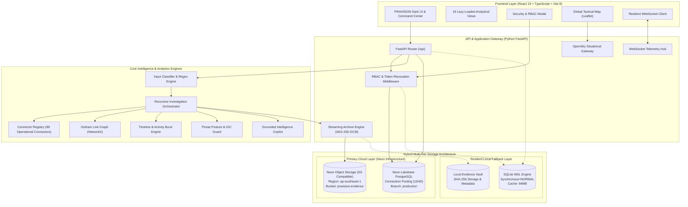

# PRAVISION — FINAL SYSTEM ARCHITECTURE (PHASE 2.5)

**Platform:** PRAVISION — Universal OSINT & Intelligence Platform  
**Architecture:** Modern Decoupled Cloud-Native / Local-First Hybrid Architecture  
**Release:** Phase 2.5 — Final Production Baseline  
**Date:** November 2026  
**Security Classification:** RESTRICTED / OPERATIONAL SPECIFICATION  

---

## 1. ARCHITECTURAL OVERVIEW

PRAVISION is an enterprise-grade, intelligence-community-oriented Universal Open Source Intelligence (OSINT) workstation designed to operate seamlessly across both secure cloud environments (Neon Lakebase PostgreSQL + Neon Object Storage S3) and air-gapped local environments (SQLite WAL mode + Local Evidence Vault).

The platform balances high-performance asynchronous investigative capabilities across 89 live connectors and 7 specialized investigation modes with rigorous multi-user Role-Based Access Control (RBAC), end-to-end authenticated cryptographic streaming archives, and real-time situational telemetry.

---

## 2. CORE COMPONENT SUBSYSTEMS

### 2.1 Frontend Presentation Tier (React 19 + Vite 8)
- **Framework:** React 19.3.1 with strict concurrent rendering mode and custom error boundaries.
- **Code Splitting & Lazy Loading:**
  - Route-level and view-level chunking utilizing `lazyWithRetry` wrapper.
  - 19 independent secondary analytical view bundles (`vendor-leaflet`, `vendor-icons`, `GothamGraphView`, `GlobalMapView`, `CasesView`, etc.).
  - Main bundle footprint optimized to 253 KB (76.4 KB gzip), with sub-second asset compilation.
- **State Management & Authentication:**
  - Centralized authenticated fetch wrapper (`authFetch`) injecting bearer tokens from secure local session storage.
  - Granular RBAC user profile management (`UserProfile`) tracking role assignments (`admin`, `case_officer`, `analyst`) and active token freshness.
  - Interactive dark-mode security modal (`LoginModal.tsx`) with fast one-click role switching presets and real-time credential validation.
- **Real-Time Visualization:**
  - **Gotham Link Graph:** NetworkX topology rendered via dynamic Canvas/SVG with force-directed physics, modularity clustering, and degree centrality filtering.
  - **Global Tactical Map:** Leaflet map with CartoDB dark tiles, multi-source layer controls (evidence GPS coordinates, USGS earthquake feeds, and backend-proxied OpenSky ADS-B flights).

### 2.2 Application & Intelligence Tier (FastAPI)
- **Runtime:** Python 3.12.10 on Uvicorn ASGI server with non-blocking async event loops.
- **Input Classification Engine:**
  - Automated heuristics and regex pattern matching classifying inputs across 20 distinct entity types (domains, emails, usernames, IPs, hashes, BTC/crypto addresses, phone numbers, geo-coordinates, document files).
- **Recursive Investigation Orchestration:**
  - Multi-threaded task execution queue with configurable depth controller (levels 1-4) and entity expansion boundaries (default cap: 1,500 discovered nodes).
  - Real-time event broadcasting over persistent WebSocket channels (`/api/investigations/{id}/live`) featuring client deduplication and tab-visibility auto-resume.
- **OpenSky Situational Telemetry Gateway:**
  - Server-side asynchronous proxy (`OpenSkyService`) eliminating browser CORS restrictions.
  - Strict coordinate bounding-box validation preventing coordinate inversion attacks.
  - In-memory 15-second TTL cache shielding OpenSky upstream servers from rate spikes.
  - Truthful degraded state reporting and graceful fallback to cached telemetry during upstream rate limits (HTTP 429) or timeouts.

### 2.3 Cryptographic Streaming Archive Engine
- **Format:** Authenticated streaming container format (`.pravision_archive`) starting with 6-byte magic identifier `PVARC\x01`.
- **Chunked Encryption:**
  - Streaming uncompressed tar generation without buffering complete multi-gigabyte files in RAM.
  - 64 KB memory-bounded chunk processing using **AES-256-GCM** authenticated encryption.
  - Unique derived 12-byte nonces per chunk (`HMAC-SHA256(active_key, base_nonce || chunk_index)[:12]`), mathematically preventing nonce-reuse vulnerabilities across massive archives.
  - Explicit 8-byte chunk headers with sequence enforcement and 64-bit EOF marker (`chunk_index=0xFFFFFFFF, length=0`).
  - Bit-flip tamper detection: immediate cryptographic authentication failure before any bytes are written to disk.
  - Path traversal guards: strict rejection of absolute paths (`/`) or directory traversal sequences (`..`).

### 2.4 Hybrid Persistence & Storage Tier
- **Primary Relational Layer (Neon Lakebase PostgreSQL):**
  - Hosted in AWS `ap-southeast-1` on Neon serverless PostgreSQL engine.
  - Managed asyncpg connection pool (`pool_size=15`, `max_overflow=25`, `pool_timeout=30s`, `pool_recycle=300s`, `pool_pre_ping=True`).
  - Full relational mapping: `users`, `case_memberships`, `revoked_tokens`, `cases`, `investigations`, `entities`, `relationships`, `evidences`, `audit_logs`.
- **Primary Object Storage Layer (Neon Object Storage):**
  - S3-compatible cloud object store in AWS `ap-southeast-1` (`pravision-evidence`).
  - Asynchronous chunked uploads with SHA-256 pre-computation and verified download checksums.
  - Strict private ACLs blocking unauthenticated public probes (verified HTTP 403 Forbidden).
- **Autonomous Local Fallbacks:**
  - High-performance SQLite engine operating in Write-Ahead Logging (`WAL`) mode with `foreign_keys=ON` and `synchronous=NORMAL`.
  - Local Evidence Vault organizing raw binary evidence under strict directory structures (`data/vault/{investigation_id}/`).

---

## 3. ACCESS CONTROL MATRIX

| Subsystem / Resource | Admin | Case Officer | Analyst | Public / Unauthenticated |
| :--- | :---: | :---: | :---: | :---: |
| **User Directory (`/api/auth/users`)** | Read / Write | DENIED (403) | DENIED (403) | DENIED (401) |
| **Role & Status Management** | Full Control | DENIED (403) | DENIED (403) | DENIED (401) |
| **System Settings & Purge** | Full Control | Read Only | Read Only | DENIED (401) |
| **Case Creation** | Allowed | Allowed | Allowed | Allowed (Zero-History) |
| **Owned Cases** | Read / Write | Read / Write | Read / Write | Isolated |
| **Unshared Private Cases** | Read / Write | DENIED (403) | DENIED (403) | DENIED (401/404) |
| **Shared Cases (Read Permission)** | Read / Write | Read Only | Read Only | DENIED (403) |
| **Case Member Management (`/share`)** | Allowed | Owned Cases | DENIED (403) | DENIED (401) |
| **Streaming Archive Creation** | Allowed | Allowed | Permitted Cases | DENIED (401) |
| **Streaming Archive Restoration** | Allowed | Allowed | DENIED (403) | DENIED (401) |
| **Flight Telemetry Gateway** | Full Access | Full Access | Full Access | Rate-Limited |
| **89 Connectors Execution** | Full Access | Full Access | Full Access | Zero-History Scope |

---

## 4. RELIABILITY & RECOVERY CHARACTERISTICS

1. **Database Reconnect & Retry Loop:**
   - Database initialization (`init_db`) incorporates a 3-attempt exponential backoff loop with 1.0-second delay intervals, seamlessly absorbing transient network DNS blips or cold-start timeouts.
2. **Dual-Path Storage Architecture:**
   - Any write failure to Neon Object Storage triggers automatic fallback storage into the Local Evidence Vault, ensuring evidence collected during active operations is never lost due to network fluctuations.
3. **Session Revocation Store:**
   - Active user sessions maintain cryptographic JWT tokens with random UUID `jti` identifiers. Token revocation (`/api/auth/logout`) registers the `jti` in persistent database storage, enforcing immediate token invalidation across all distributed nodes.
4. **Ephemerality & Zero-History Mode:**
   - Unsaved investigations reside exclusively in memory. Session termination or manual invocation of "Clear Investigation" eradicates investigation nodes, edges, raw payloads, and temporary media files without disk remnants.

